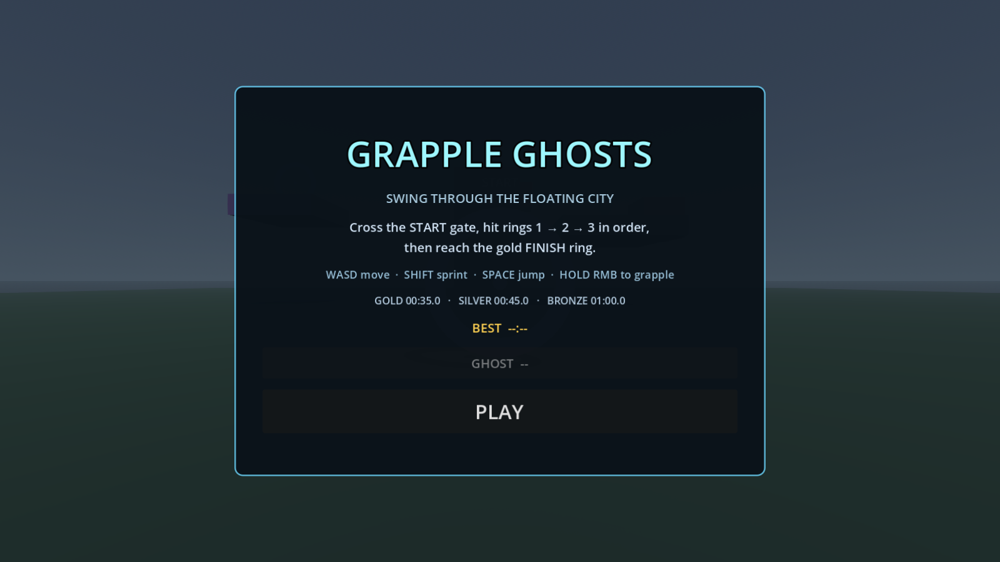
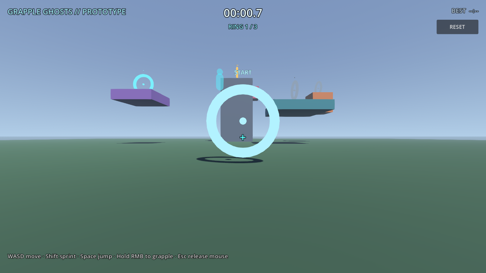

# Grapple Ghosts

**Swing through a floating city and race your ghosts.**

A 3D grapple-hook time-trial game for Android, built with Godot 4.7.
This repository is a playable time-trial prototype for the phone.



## Start screen

The game opens on a title card with the current best time, a short course
briefing and a **PLAY** button. Press **Enter** or **Space** on desktop to start.
The Godot splash logo is disabled, so only the dark boot background shows
before the start screen.

The Android build now uses sensor landscape, so it follows the phone between
both landscape orientations instead of staying locked to one side.


## The first course

Cross the **START** gate, touch rings **1 → 2 → 3** in order, then the gold
**FINISH** ring on the tower. The timer starts at the gate and stops at the
finish; your best time, splits and a ghost replay are saved locally.


- Ring 1: purple island (left)
- Ring 2: orange cube above the teal slab (right)
- Ring 3: teal slab (middle)
- Finish: tower top

## Medals

| Medal | Time |
|---|---|
| Gold | 00:35.0 |
| Silver | 00:45.0 |
| Bronze | 01:00.0 |

The active ring is cyan, completed rings turn green, future rings are gray.
Out-of-order rings are ignored and the HUD tells you which ring is next.

**Ring centers are grapple anchors.** Aim at the glowing orb inside the hoop
until the crosshair turns cyan, then hold **GRAPPLE** to reel in and swing.
Release over the platform to land and keep your momentum. The 2nd/3rd platforms
are high on purpose — grapple the ring, swing, and release.

## Swing, ghosts and medals

- Rope constraint, reel-in, release boost, coyote time and jump buffering
- Speed-based FOV kick
- Best run replay as a translucent cyan ghost; toggle it from the start screen
- Ring split times with a live delta against your best splits
- **GOLD 00:35.0 · SILVER 00:45.0 · BRONZE 01:00.0**
- Medals shown in the finish panel




## Prototype controls

| Action | Desktop | Phone |
|---|---|---|
| Move | WASD | Left stick |
| Look | Mouse | Drag on the right side |
| Sprint | Shift | Push the stick to the edge |
| Jump | Space | JUMP |
| Grapple | Hold right mouse | Hold GRAPPLE |
| Release the mouse | Esc | — |
| Restart | R | RESET button |

The cyan blocks and the tower are grappleable. Swing around, climb the tower,
then try to cross the gaps without touching the ground.

## Performance

- 60 FPS cap on mobile; 3D physics interpolation makes the 60 Hz body smooth on 120 Hz screens
- FXAA instead of 2× MSAA, 100 m directional shadow distance and a 400 m camera far plane
- Aim raycast runs at 25 Hz with a reusable query instead of allocating every frame
- The rope is a persistent stretched mesh, not an `ImmediateMesh` rebuilt every physics tick
- Timer text updates at 20 Hz; touch controls redraw only on touch/resize
- Reference desktop result: ~64 FPS, 49 draw calls, ~18.9k primitives

## Run

```bash
godot --path .
```

## Course smoke test

```bash
godot --headless --path . --script res://tests/course_smoke.gd
```

## Android build

```bash
godot --headless --path . --export-debug "Android" build/grapple-ghosts.apk
adb install -r build/grapple-ghosts.apk
```

The Android preset targets `arm64-v8a` and uses the package
`com.soda.grappleghosts`.

## Roadmap

1. ~~**Swing feel**~~ — rope constraint, reel-in, release boost, coyote time, FOV kick.
2. ~~**Course**~~ — start gate, three ordered rings and a tower finish.
3. ~~**Ghosts**~~ — record and replay the best run, toggle on the start screen.
4. ~~**Timer**~~ — live timer, saved best, ring splits and medals.
5. ~~**Touch controls**~~ — left stick, drag look, hold GRAPPLE, JUMP; tested on the phone.
6. **Characters** — anime skins from Blender, third-person optional.
7. **Content** — three routes, shortcuts, secrets, weather/time of day.

## Design rules

- The fun must be in the **movement**, not in unlocks or story.
- No combat, inventory or open world until the swing loop is genuinely fun.
- Every course should be readable at speed and support at least two lines.
- Keep runs short enough for a phone session.

## Status

Playable first course with mobile controls, swing physics, timer, splits,
medals and a best-run ghost replay. Not a finished game.
