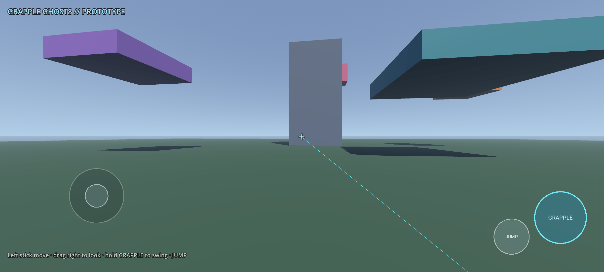
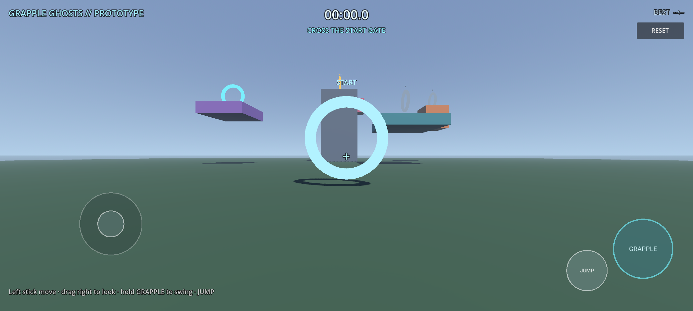

# Grapple Ghosts

**Swing through a floating city and race your ghosts.**

A 3D grapple-hook time-trial game for Android, built with Godot 4.7.
This repository is a playable time-trial prototype for the phone.



## The first course

Cross the **START** gate, touch rings **1 → 2 → 3** in order, then the gold
**FINISH** ring on the tower. The timer starts at the gate and stops at the
finish; your best time is saved locally.



- Ring 1: purple island (left)
- Ring 2: orange cube above the teal slab (right)
- Ring 3: teal slab (middle)
- Finish: tower top

The active ring is cyan, completed rings turn green, future rings are gray.
Out-of-order rings are ignored and the HUD tells you which ring is next.


## Prototype controls

| Action | Desktop | Phone |
|---|---|---|
| Move | WASD | Left stick |
| Look | Mouse | Drag on the right side |
| Sprint | Shift | Push the stick to the edge |
| Jump | Space | JUMP |
| Grapple | Hold right mouse | Hold GRAPPLE |
| Release the mouse | Esc | — |
| Restart | R | RESET button |

The cyan blocks and the tower are grappleable. Swing around, climb the tower,
then try to cross the gaps without touching the ground.

## Run

```bash
godot --path .
```

## Course smoke test

```bash
godot --headless --path . --script res://tests/course_smoke.gd
```

## Android build

```bash
godot --headless --path . --export-debug "Android" build/grapple-ghosts.apk
adb install -r build/grapple-ghosts.apk
```

The Android preset targets `arm64-v8a` and uses the package
`com.soda.grappleghosts`.

## Roadmap

1. **Swing feel** — rope tension, reel-in, release boost, coyote time.
2. ~~**Course**~~ — start gate, three ordered rings and a tower finish.
3. **Ghosts** — record the player's transform and replay the best run as a ghost.
4. ~~**Timer**~~ — live timer and saved best; medals next.
5. ~~**Touch controls**~~ — left stick, drag look, hold GRAPPLE, JUMP; tested on the phone.
6. **Characters** — anime skins from Blender, third-person optional.
7. **Content** — three routes, shortcuts, secrets, weather/time of day.

## Design rules

- The fun must be in the **movement**, not in unlocks or story.
- No combat, inventory or open world until the swing loop is genuinely fun.
- Every course should be readable at speed and support at least two lines.
- Keep runs short enough for a phone session.

## Status

Playable first course with mobile controls, timer and best time. Not a finished game.
